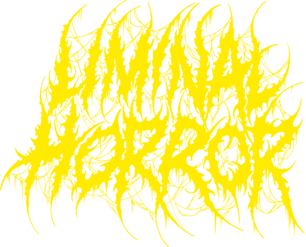
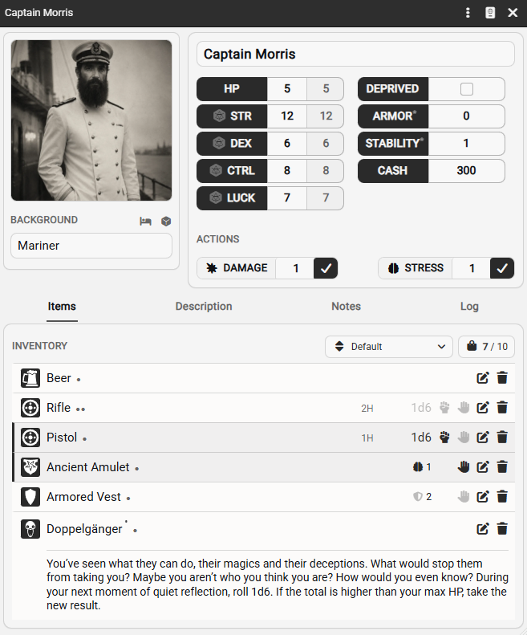
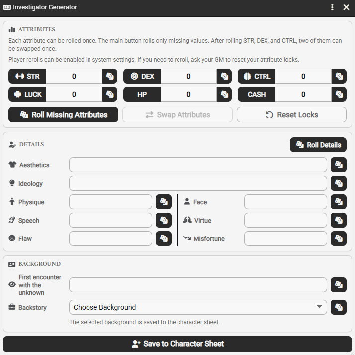
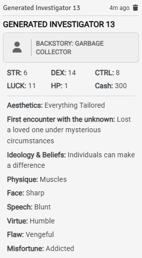
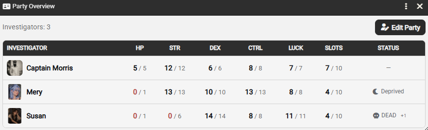
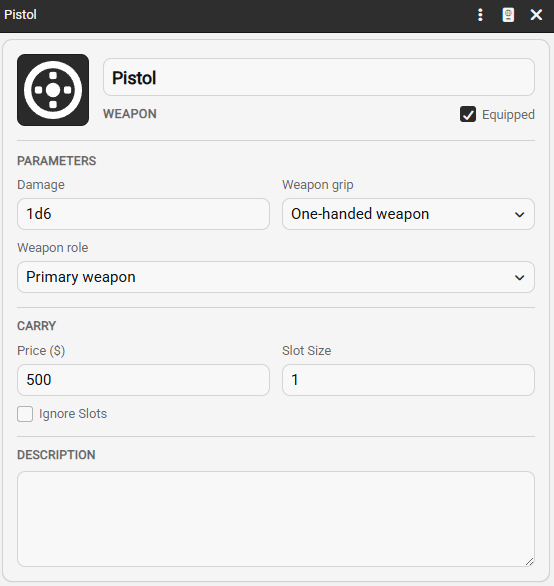
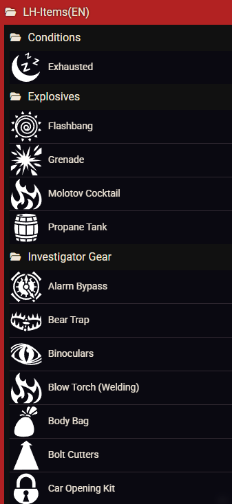

<div align="center">
  

  <h1>Liminal Horror for Foundry VTT</h1>

  <p>Investigator sheets, character generation, and tools for the Facilitator.</p>

  <p>
    
    
    
    <a href="https://creativecommons.org/licenses/by-sa/4.0/"></a>
  </p>

  <p>
    <a href="#installation">Install</a> ·
    <a href="#features">Features &amp; screenshots</a> ·
    <a href="CHANGELOG.md">Changelog</a> ·
    <a href="https://666f78.pp.ua/donate">Support development</a>
  </p>
</div>

An **unofficial system** for playing [Liminal Horror](https://liminalhorrorrpg.com) in [Foundry Virtual Tabletop](https://foundryvtt.com). Manage investigators, roll saves and attacks, track equipment and protection, and generate characters with their backgrounds and starting items.

Available in **English** and **Українська**. Designed for **Foundry VTT v14**.

> This is an independent adaptation by **D.H. / 666f78**, not affiliated with or endorsed by the creators of Liminal Horror.

## Installation

1. Open Foundry VTT and go to **Game Systems → Install System**.
2. Paste this URL into **Manifest URL**:

   ```text
   https://github.com/666f78/liminal-horror/releases/latest/download/system.json
   ```

3. Click **Install**, then create a world using **Liminal Horror**.

For manual installation, download `system.zip` from the [latest release](https://github.com/666f78/liminal-horror/releases/latest) and extract the system into `Data/systems/liminal-horror`.

<details>
  <summary>Legacy installation for Foundry VTT v12</summary>

The v12 version is no longer updated. Use the manifest for release **0.1.0**:

```text
https://github.com/666f78/liminal-horror/releases/download/0.1.0/system.json
```

</details>

## Features

### Investigator sheets

Keep attributes, HP, cash, armor, Stability, and inventory together. Roll directly from the sheet, expand item descriptions, and use separate tabs for character descriptions, notes, and the GM log.

- Slot-based inventory with manual drag-and-drop ordering and sorting options.
- Equipped weapon and spell attacks, primary and offhand weapon slots, and two-handed weapons.
- Automatic dual-wielding rolls that keep the highest result, with configurable offhand die reduction.
- Separate physical and stress protection, with automatic totals from equipped armor or manual values.
- Optional **Appendix L: Luck**, including spending Luck and undoing the expenditure.
- Limited-permission investigator views and sheets for NPCs, monsters, and vehicles.

<p align="center">
  <a href="docs/sheet.png"></a>
</p>

### Investigator generation

Build an investigator step by step from the sheet's **Investigator Generator**, or use **Generate Investigator** in the Actors directory to create one with rolled stats, descriptive details, a backstory, and starting equipment. The result is also posted to chat.

The sheet generator supports individual rolls, rolling only missing attributes, attribute swapping, and configurable player rerolls.

<table>
  <tr>
    <th width="65%">Investigator Generator</th>
    <th width="35%">Generated investigator in chat</th>
  </tr>
  <tr>
    <td align="center" valign="top">
      <a href="docs/investigator-generator.png"></a>
    </td>
    <td align="center" valign="top">
      <a href="docs/random-investigator-generator.png"></a>
    </td>
  </tr>
</table>

### Party Overview

Give the Facilitator a shared view of the selected investigators: HP, attributes, optional Luck, inventory slots, and statuses. The GM can edit the party, open character sheets from the table, and inspect additional statuses through tooltips. Values update as characters change.

<p align="center">
  <a href="docs/party-overview.png"></a>
</p>

### Items and equipment

Use the starter item compendium or create your own weapons, spells, armor, gear, artifacts, injuries, consequences, and conditions. New items receive a monochrome icon for their type; click an item's image to choose your own.

Weapon sheets include damage, handedness, and primary/offhand assignment. Armor can provide physical protection, stress protection, or both. Equipment changes are grouped into one chat message showing what was removed and equipped.

<table>
  <tr>
    <th width="60%">Item sheet</th>
    <th width="40%">Starter item compendium</th>
  </tr>
  <tr>
    <td align="center" valign="top">
      <a href="docs/item-sheet.png"></a>
    </td>
    <td align="center" valign="top">
      <a href="docs/compendium-items.png"></a>
    </td>
  </tr>
</table>

### Tools for the Facilitator

Apply damage and stress, manage injuries and consequences, roll backgrounds, and use Voidcrawl tools. Integrated chat cards display rolls, item use, equipment changes, and generated investigator details.

## Getting started

1. Create an **Investigator** in the Actors directory, or click **Generate Investigator** for a random character.
2. Open the sheet's **Investigator Generator** to roll or fill in character details step by step.
3. Add items from the compendium or create them yourself, then equip the weapons, spells, and armor you want to use.
4. Click an equipped weapon's damage die to attack, or an attribute to roll a save.
5. As GM, open **Party Overview** from the Actors directory and choose the investigators to track.

System settings control automatic protection totals, dual-wielding die reduction, generator rerolls, and **Appendix L: Luck**.

## Roadmap

- [ ] Appendix C: Conditions
- [ ] Appendix I: Item Tags
- [ ] Appendix T: Time Procedures

See [CHANGELOG.md](CHANGELOG.md) for release notes and completed changes.

## Feedback and contributions

[Report a bug](https://github.com/666f78/liminal-horror/issues) or [start a discussion](https://github.com/666f78/liminal-horror/discussions). Feature requests, pull requests, and English or Ukrainian translation improvements are welcome. Submit localization changes in the corresponding `lang/*.json` files.

If you would like to help fund ongoing work, [support development](https://666f78.pp.ua/donate).

## Credits and license

**Liminal Horror** was created by **Goblin Archives, Josh Domanski, and Zach Hazard Vaupen**. This Foundry VTT adaptation is developed by **D.H. / 666f78**.

The original game and this adaptation are released under the [Creative Commons Attribution-ShareAlike 4.0 International License](https://creativecommons.org/licenses/by-sa/4.0/). You may share and adapt this work with appropriate credit to the original creators and the adaptation's author, and must distribute adaptations under the same license.

Liminal Horror © Goblin Archives, Josh Domanski, and Zach Hazard Vaupen. Foundry VTT system adaptation © D.H. / 666f78. This project is not affiliated with, endorsed, or sponsored by the original creators.
